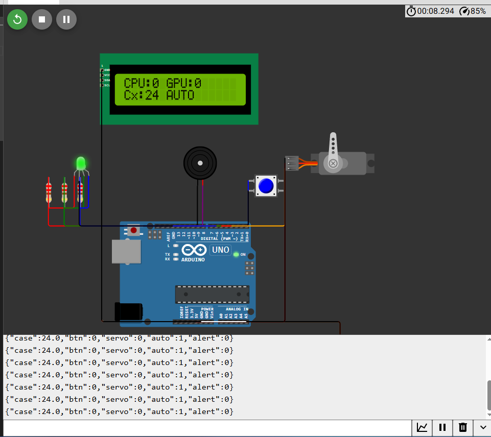
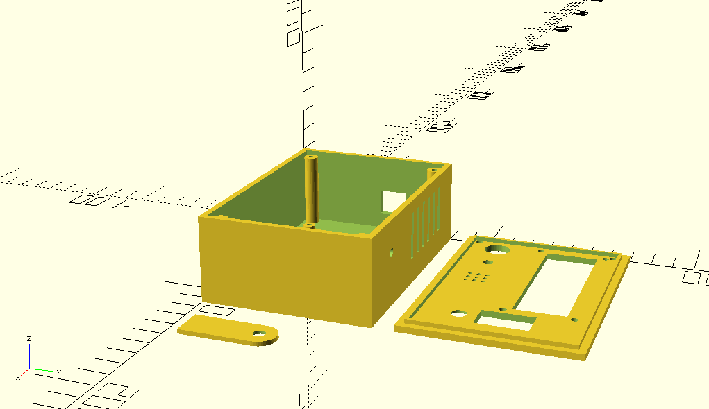
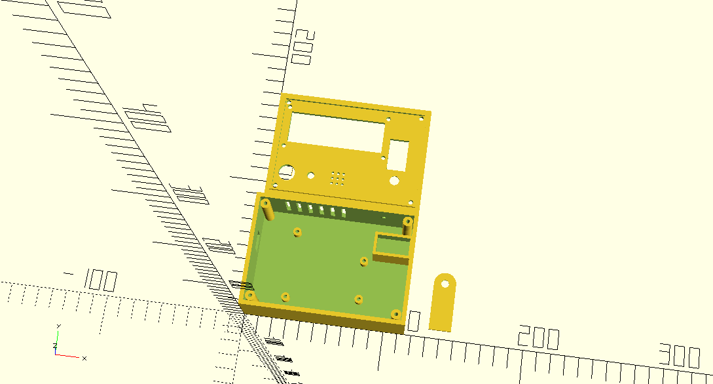
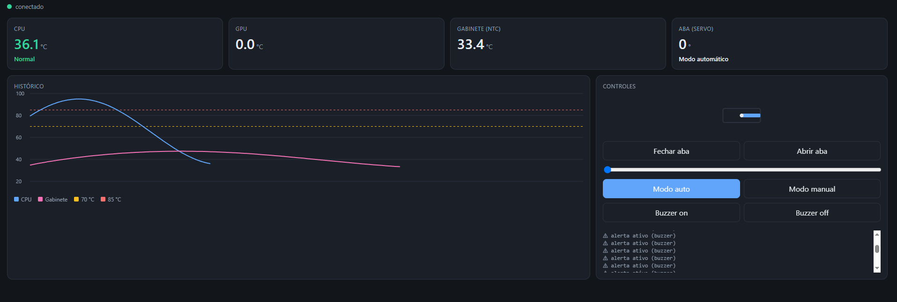
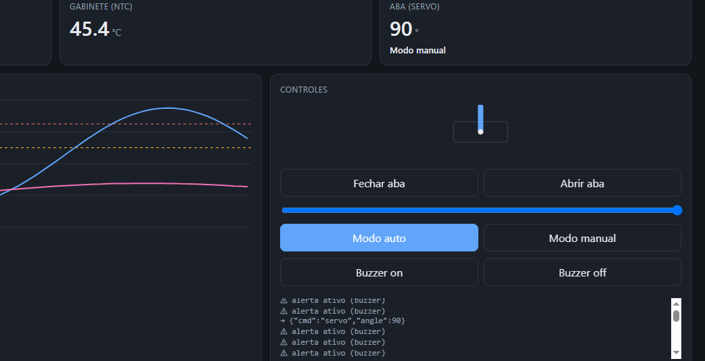

# Harm Sentinel

### Server created

Using cargo with command `cargo new {server_name}`
Server will be bidirectional websocket patterns.

## Requirements

- Rust
- Cargo (rust)
- Tokio

### Dev dependecies
- Axum
- rust-embed
- mime_guess
- open

## Diagrama (Wokwi)

https://wokwi.com/projects/481066756096417793

## Modelagem 3D
**Nota:** (Apenas fins de estudo, não foi feito fisicamente)

## Screenshots

**Dashboard geral web**

**Mudando a aba do servo para ventilação**

